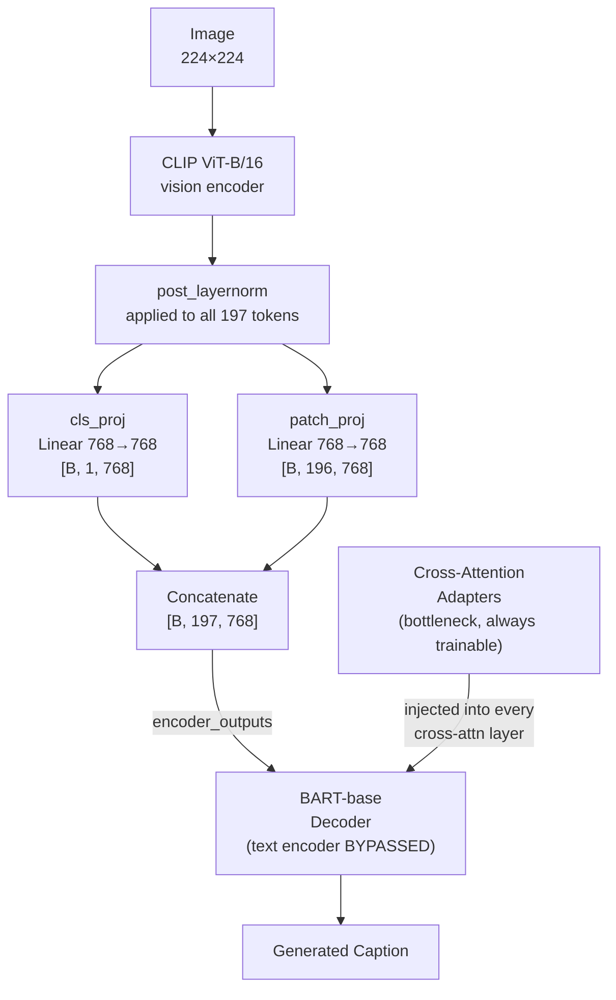

# E0-R — Non-semantic Image Captioning Baseline

CLIP ViT-B/16 + BART-base captioner with no semantic modules.
This is the frozen reference baseline for the NLU-guided captioning project.
E1x models subclass `E0RCaptioner`.

---

## Architecture



---

## Freeze Schedule

```mermaid
gantt
    title Freeze Schedule (5 Epochs)
    dateFormat  X
    axisFormat  Ep %s

    section CLIP backbone
    Frozen (all layers)          :done,  e1, 1, 3
    Top-3 layers + post_LN unfrozen :active, e5, 5, 6

    section BART cross-attention
    Trainable                    :active, ca, 1, 6

    section BART top-2 decoder layers
    Frozen                       :done,  d12, 1, 3
    Trainable                    :active, d34, 3, 6

    section Adapters (cross-attn)
    Always trainable             :active, ad, 1, 6

    section Projection heads
    Always trainable             :active, pr, 1, 6
```



| Stage | Epochs | CLIP | BART trainable parts | Adapters |
|-------|--------|------|----------------------|----------|
| 1     | 1–2    | fully frozen | cross-attention only | ✓ |
| 2     | 3–4    | fully frozen | cross-attention + top-2 decoder layers | ✓ |
| 3     | 5      | top-3 layers + post_layernorm | cross-attention + top-2 decoder layers | ✓ |

Projection heads (`patch_proj`, `cls_proj`) and BART lm_head / embeddings are
always trainable.

---

## Frozen E0-R Targets

These values are **immutable** — do not edit them. They are the reference
point for all E1x comparisons via `scripts/compare.py`.

| Metric   | Value      |
|----------|-----------|
| BLEU-1   | 77.60 %   |
| BLEU-2   | 61.70 %   |
| BLEU-3   | 47.50 %   |
| BLEU-4   | 36.30 %   |
| METEOR   | 28.00 %   |
| ROUGE-L  | 57.20 %   |
| CIDEr    | 118.30    |
| CHAIR_s  | 7.98 %    |
| CHAIR_i  | 5.3451 %  |

---

## Hyperparameters — TODOs

The following must be filled in `configs/e0r.yaml` **before training**:

| Key | Suggested range | Notes |
|-----|----------------|-------|
| `training.batch_size` | 32–64 | depends on GPU VRAM |
| `training.gradient_accumulation_steps` | 1–4 | to simulate larger batch |
| `training.optimizer.lr` | 1e-4 – 5e-5 | |
| `training.optimizer.weight_decay` | 0.01 | standard AdamW |
| `training.scheduler.warmup_steps` | 300–1000 | ~5% of total steps |
| `eval.batch_size` | 64 | |
| `eval.beam_size` | 4 | |
| `eval.max_new_tokens` | 30 | |
| `eval.min_length` | 5 | |
| `eval.length_penalty` | 1.0 | |
| `eval.no_repeat_ngram_size` | 3 | |
| `kaggle.dataset_owner` | — | your Kaggle username |
| `kaggle.dataset_slug` | — | e.g. `e0r-checkpoints` |

---

## Project Layout

```
image_captioning/
├── configs/
│   └── e0r.yaml                  # all config (fill TODOs before training)
├── src/
│   ├── models/e0r.py             # E0RCaptioner
│   ├── data/coco.py              # COCO 2017 dataset + dataloaders
│   ├── training/
│   │   ├── freeze.py             # FreezeScheduler
│   │   └── trainer.py            # AMP trainer + checkpointing
│   └── eval/metrics.py           # BLEU/METEOR/ROUGE-L/CIDEr/CHAIR
├── scripts/
│   ├── train.py                  # training entry point
│   ├── evaluate.py               # beam search + metrics
│   ├── compare.py                # diff vs E0-R targets
│   └── kaggle_ckpt.py            # push/pull checkpoint to Kaggle
├── tests/
│   ├── test_model_shapes.py
│   └── test_freeze_stages.py
└── README.md
```

---

## Data Layout

Expected COCO 2017 layout (relative to repo root):

```
data/coco/
├── train2017/          # ~118k images
├── val2017/            # ~5k images
└── annotations/
    ├── captions_train2017.json
    └── captions_val2017.json
```

---

## Quick Start

### 1. Install dependencies

```bash
pip install torch torchvision transformers \
            pycocoevalcap pycocotools \
            nltk pyyaml tqdm kaggle
```

### 2. Fill config TODOs

Edit `configs/e0r.yaml` and replace every `TODO` value.

### 3. Train

```bash
python scripts/train.py --config configs/e0r.yaml
```

Resume from a checkpoint:

```bash
python scripts/train.py --config configs/e0r.yaml \
    --resume outputs/e0r/ckpt_epoch03.pt
```

### 4. Evaluate (epoch 5 checkpoint)

```bash
python scripts/evaluate.py \
    --config configs/e0r.yaml \
    --checkpoint outputs/e0r/ckpt_epoch05.pt
```

Metrics and predictions saved to `outputs/e0r/`.

### 5. Compare against E0-R targets

```bash
python scripts/compare.py --metrics outputs/e1a/metrics.json
```

---

## Kaggle Checkpoint Workflow

### Setup

```bash
# Install Kaggle CLI
pip install kaggle

# Authenticate (choose one)
export KAGGLE_USERNAME=<your-username>
export KAGGLE_KEY=<your-api-key>
# OR place credentials in ~/.kaggle/kaggle.json
```

Fill `kaggle.dataset_owner` and `kaggle.dataset_slug` in `configs/e0r.yaml`.

### Push latest checkpoint

```bash
python scripts/kaggle_ckpt.py push --config configs/e0r.yaml
```

### Pull latest checkpoint

```bash
python scripts/kaggle_ckpt.py pull --config configs/e0r.yaml
```

### Pull and verify resume

```bash
python scripts/kaggle_ckpt.py pull --config configs/e0r.yaml --verify
```

---

## Run Tests

```bash
pytest tests/ -v
```

---

## Extending to E1x

Subclass `E0RCaptioner`:

```python
from src.models.e0r import E0RCaptioner

class E1aCaptioner(E0RCaptioner):
    def __init__(self, ...):
        super().__init__(...)
        # add semantic modules here

    def encode_image(self, pixel_values):
        # call super().encode_image() then inject semantics
        ...
```

The `encode_image` → `forward` → `generate` interface is stable.
